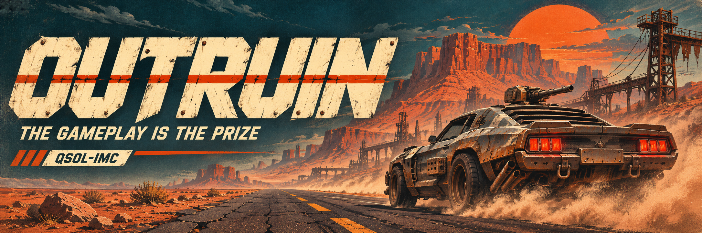

<div align="center">



# OUTRUIN

### The cities went quiet. The highway didn’t.

[](https://github.com/QSOLKCB/Outruin/actions/workflows/verify.yml)
[](https://qsolkcb.github.io/Outruin/)
[](LICENSE)
[](https://github.com/QSOLKCB/VANILLAJS)
[](https://github.com/QSOLKCB/OPT)
[](docs/MODDING.md)
[](#run-it-locally)

**Drive. Fight. Scavenge. Rebuild. Make your own wasteland.**

**0.2 — Road Reborn:** speed-sensitive steering, continuous bends, matching road/shoulder coordinates, a rebuilt chase view, visible enemy rounds you can dodge, and a longer VANILLAJS soundtrack. [What changed and how it was checked](docs/ROAD_REBORN.md).

**Now transmitting — Wasteland Radio:** five eight-phrase arrangements, layered deterministic effects, engine/boost/tyre audio, separate volume controls, and Workshop auditions with WAV exports. [Audio notes](docs/AUDIO.md).

[Play in your browser](https://qsolkcb.github.io/Outruin/) · [Modding guide](docs/MODDING.md) · [Controls](#know-your-machine) · [Engineering](docs/ARCHITECTURE.md) · [Roadmap](ROADMAP.md)

</div>

---

## One machine. One signal. One last run.

The relay network has gone silent. Somewhere beyond the rust, the salt and the black glass, a coastal transmitter is still answering. You have its signal core, an armed vehicle and just enough fuel to make a questionable decision.

**Outruin is an original browser driving-and-combat game inspired by Overlander and Outlander.** It brings together hostile highways, forward and side guns, resource pressure, on-foot scavenging, and the pleasure of getting a battered machine just a little further down the road.

No accounts. No monetisation. No engine download. The gameplay **is** the prize.

This is the first playable campaign, not a claim of feature parity with either inspiration. All game code, worlds, procedural art and music are original or explicitly attributed QSOLKCB components. No ROMs, original game assets, copied soundtracks or branded vehicles are included.

## What is on the road?

| System | Playable now |
| :--- | :--- |
| **The Last Signal** | Three regions, 8.4 km of authored campaign distance, relay stops and a final war rig encounter |
| **Driving** | Speed-sensitive steering, wheel return, continuous corners, braking grip, loose shoulders and rechargeable boost |
| **Vehicle combat** | Target brackets, forward and side tracers, telegraphed travelling enemy fire, weaving bikes/buggies, haulers and a boss |
| **Scavenging** | Leave the car, walk and jump through an outpost, fight raiders and recover supplies |
| **Survival** | Fuel, armour, health, ammunition and single-use supply crates |
| **Progression** | Spend scrap on repairs, fuel, ammunition, an engine tune or a stronger forward gun |
| **Route choice** | Open highway or sharper canyon bends with more patrols and hazard pay |
| **Difficulty** | Drifter, Survivor and Wastelord alter damage, patrol frequency and supply pressure |
| **Sound** | Eight-phrase industrial/chiptune scores for three regions, outposts and the boss; layered PCM weapons, impacts, supplies and engine sounds |
| **Workshop** | Edit, validate, import and export complete JSON content packs; audition and export each radio mix or effect |
| **Input** | Keyboard, remappable Xbox/standard and generic SNES profiles, simultaneous touch controls |
| **Offline** | A versioned local cache after the first successful load; no runtime CDNs or services |
| **Replay evidence** | Download a tick-input record with the exact campaign pack and shop/route decisions |

## The wasteland is yours

**Levels, cars, weapons, enemies, balance, colours and music are data.** Open **WORKSHOP** from the game, change the pack, and choose **VALIDATE & APPLY**. The new campaign starts from the garage. Your active run never silently changes underneath you.

Use the quick fields for campaign name, vehicle name, paint and top speed. The full JSON editor exposes the rest:

- Add, remove, rename, lengthen or recolour regions; change the bend sequence and final encounter position.
- Build a fast buggy, an armoured hauler or an interceptor. Change acceleration, steering, grip, braking, armour, fuel and boost.
- Tune weapon damage, cadence, ammunition cost and range.
- Change enemy health, speed, damage, attack intervals, salvage and score rewards.
- Move outpost supplies and enemies; rebalance fuel, ammunition, repairs, shop prices and difficulty.
- Compose a new soundtrack from integer pitches, bass notes, melody steps, tempo, waveform and gain.

### Three packs to start from

| Pack | Machine | Character |
| :--- | :--- | :--- |
| [The Last Signal](mods/the-last-signal.json) | **Dust Kestrel** interceptor | The original balanced campaign |
| [Heavy Metal](mods/heavy-metal.json) | **Iron Gospel** hauler | More armour, slower handling, heavy shots and longer roads |
| [Night Courier](mods/night-courier.json) | **Glass Needle** buggy | More speed, less armour and a cold electric skyline |

These are complete editable examples, not locked presets. Share the JSON and someone else can import your campaign. The pack format is deliberately bounded and contains no executable scripts. New mechanics, additional enemy types and custom rendering belong in the open source; the guide shows where to extend them.

**[Read the complete modding guide →](docs/MODDING.md)**

## Know your machine

| Action | Keyboard | Xbox / standard | Generic SNES default |
| :--- | :--- | :--- | :--- |
| Steer / walk | A / D or ← / → | Left stick / D-pad | Horizontal axis |
| Accelerate | W or ↑ | RT / D-pad up | Vertical axis up |
| Brake | S or ↓ | LT / D-pad down | Vertical axis down |
| Forward / on-foot gun | Space | A | Button 0 |
| Boost | X / Shift | B | Button 1 |
| Stop / search / return | E / F | X | Button 3 |
| Jump on foot | J | Y | Button 2 |
| Left / right side guns | Q / C | LB / RB | Buttons 4 / 5 |
| Pause / resume | P / Escape | Start | Button 9 |

Generic USB pads do not share a universal button order. Open **CONTROLS**, choose a profile, then click any action and press the desired button or move an axis. Mappings are saved locally. A disconnected pad or lost window focus pauses the run.

Android and iOS receive touch controls automatically. Desktop users can enable them in **CONTROLS**. Hold steering and throttle/fire together; releasing or cancelling a touch clears that input. Landscape gives you more road. Physical controllers and real mobile devices still need owner-side testing; browser emulation is recorded separately in [validation notes](docs/VALIDATION.md).

### First run advice

1. Start with **Drifter**. Hold **W** to accelerate — the car does not drive itself.
2. Ease into bends and brake to regain grip. The wheels can turn at a standstill, but the car needs forward speed to steer. Keep off the shoulder.
3. Green brackets mark a target in forward-gun range. Orange warnings announce incoming rounds: move out of their path. Hold **Space** only when lined up; ammunition is finite.
4. Use **Q / C** when a rider is alongside. Boost is useful, but release it after the tank empties so it can recharge for another burst.
5. Brake below the displayed stopping threshold, then press **E / F** for a roadside stop. You can scavenge once per region. An unvisited outpost also opens automatically at a relay or when fuel runs out.
6. On foot, walk close to crates and press **E / F**. Collect fuel and ammo, then return to the car and press **E** again.
7. At a relay, spend scrap and pick the next route. Destroy the final war rig before crossing the last finish line.

## A radio that can be reproduced

The soundtrack uses eight phrases with four lanes through VANILLAJS `soundtrack` and `audio2d`: an intro, variations, a fill, a breakdown, a build and a turnaround. The default road loop lasts **32 seconds**. Rust, Salt and Glass have different arrangements; outposts slow things down and the war rig pushes the tempo. The same pack, seed and mix generate the same **48 kHz mono PCM16** reference samples.

Weapons, impacts, explosions, footsteps, supplies and eight engine bands now use layered VANILLAJS PCM too. Effect variants come from the run seed and event tick; directional shots are panned at playback. **CONTROLS** has separate music, effects and engine levels. **WORKSHOP** can audition or export any radio mix and effect. Playback resumes at the simulation tick after a pause; a device failure leaves gameplay and saved sound preferences intact.

Playback timing, Web Audio mixing/resampling and physical speakers remain separate from reference-PCM determinism. [Recipes, compatibility and verification](docs/AUDIO.md).

## Built from the QSOLKCB toolbox

| Source | Actual role |
| :--- | :--- |
| **[VANILLAJS](https://github.com/QSOLKCB/VANILLAJS)** | Unmodified fixed clock, seeded RNG/math utilities, PCM renderer, multi-phrase soundtrack module and tick-synchronised Web Audio player |
| **[STREET-RACER](https://github.com/QSOLKCB/STREET-RACER)** | Reference for pseudo-3D road presentation and adapting fixed-step events to render frames |
| **[OPT](https://github.com/QSOLKCB/OPT)** | Bounded reuse of immutable sky layers and score compilations, with reference parity checks |

Exact commits, Git blob identities, SHA-256 hashes and licenses live in [vendor/PROVENANCE.json](vendor/PROVENANCE.json) and [NOTICE](NOTICE). No external repository is fetched at runtime. OPT is a mechanism applied and measured here; it does not transfer a proof or a performance claim by association.

## Run it locally

Clone or download the repository, then serve the directory:

```sh
uv run --no-project python -m http.server 8000
```

Open **http://localhost:8000**. Standard-library Python also works: `python3 -m http.server 8000`. There is no game build step, npm runtime dependency, Docker image or backend. Use an HTTP server because native ES modules and offline caching are not reliable from `file://`.

After **OFFLINE READY** appears, the cached game can reload without a connection. Browser storage can still be cleared or evicted. A downloaded checkout plus a local server is the durable offline option.

## Check the work

```sh
node --test tests/*.test.js
uv run --no-project python scripts/check.py
uv run --no-project python scripts/build.py
node tests/browser.mjs
```

Node is used for development verification, not to run the game. The browser suite needs test-only Playwright; CI installs an explicit version in a temporary directory. An existing installation can be selected with `PLAYWRIGHT_MODULES`, and `PLAYWRIGHT_CHROMIUM_EXECUTABLE` can select a local Chromium binary. See [validation](docs/VALIDATION.md).

A successful build creates the allowlisted `dist/` site. The workflow verifies pull requests and deploys that site on changes to `main`. New runtime bytes require regenerating the offline manifest with `python3 scripts/build.py --write-sw`; the integrity check rejects a stale one.

## Keep the road open

The source is the mod SDK. Make new worlds. Tune unreasonable vehicles. Write a worse radio station. Give someone a reason to drive one more sector.

**Make amazing alien tech and put it under Apache-2.0.**

[Apache-2.0](LICENSE) · QSOL-IMC · Trent Slade and contributors
